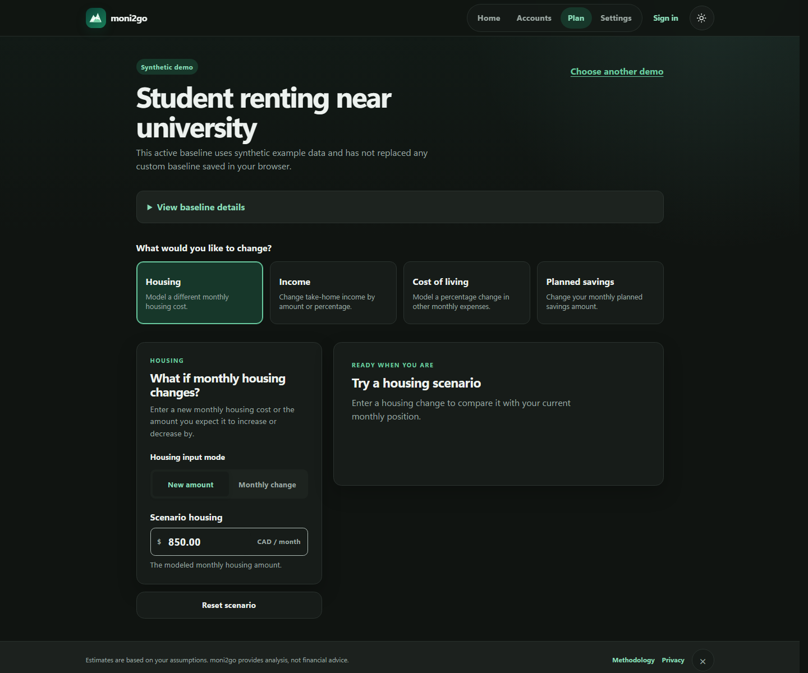

# moni2go

**A privacy-first money tracker that turns everyday activity into a clear financial picture.**

[Live application](https://moni2go.vercel.app) · [Architecture](docs/architecture.md) · [Financial logic](docs/financial-logic.md) · [Deployment](docs/deployment.md)

moni2go helps people record income, expenses, transfers, debts, bills, and monthly plans without connecting a bank account. It separates spendable cash from investments and debt, explains where every number comes from, and keeps financial decisions in the user's hands.



## What the application does

- Tracks bank, cash, credit-card, loan, investment, and cryptocurrency accounts.
- Records income, purchases, refunds, bill payments, transfers, savings movements, and debt payments.
- Calculates available cash, assets, liabilities, net worth, monthly spending, and category budgets.
- Shows recent activity with safe editing, deletion, account filtering, and balance-correction history.
- Builds 30-, 60-, and 90-day outlooks from known balances, dated income, bills, debt payments, and reliable spending history.
- Produces short, category-aware guidance while clearly labeling estimates and missing information.
- Works on mobile and desktop with keyboard navigation, accessible dialogs, and responsive layouts.

## Financial rules

Financial correctness is implemented in framework-independent domain modules rather than inside UI components.

| Activity                        | Balance effect                           | Spending effect               |
| ------------------------------- | ---------------------------------------- | ----------------------------- |
| Income received                 | Increases the selected cash account      | Income, not negative spending |
| Cash purchase                   | Reduces the selected cash account        | Counts once in its category   |
| Credit-card purchase            | Increases the card amount owed           | Counts once in its category   |
| Refund                          | Reverses relevant category spending      | Reduces spending              |
| Transfer between owned accounts | Reduces source and increases destination | Not spending or income        |
| Credit-card or loan payment     | Reduces cash and tracked debt            | Not a second purchase         |
| Savings or investment transfer  | Moves value between accounts             | Not consumption spending      |
| Balance correction              | Replaces a manually tracked balance      | Not spending or income        |

All monetary calculations use integer cents. Credit limits are never treated as cash, and investments or cryptocurrency remain part of total assets without being presented as immediately spendable money.

See [Financial logic and safeguards](docs/financial-logic.md) for the complete calculation model.

## Architecture

```text
Next.js routes and React components
                │
                ▼
Framework-independent financial domain
  accounts · transactions · budgets · forecasts
                │
        ┌───────┴────────┐
        ▼                ▼
 IndexedDB         Supabase (optional)
 local workspace   auth + private sync
```

| Area                | Responsibility                                                                           |
| ------------------- | ---------------------------------------------------------------------------------------- |
| `src/app/`          | Next.js routes and page composition                                                      |
| `src/components/`   | Accessible account, planning, dashboard, authentication, and settings workflows          |
| `src/v2/domain/`    | Money, account, transaction, recurrence, budget, spending-history, and forecasting rules |
| `src/v2/storage/`   | IndexedDB repository, schema migration, backup, and restore                              |
| `src/cloud/`        | Version-aware Supabase workspace synchronization                                         |
| `tests/unit/`       | Deterministic financial and persistence tests                                            |
| `tests/components/` | React workflow and synchronization tests                                                 |
| `tests/e2e/`        | Playwright browser, responsive, and accessibility tests                                  |

## Integrations

### Supabase

Supabase provides optional email authentication and private workspace synchronization. Row Level Security restricts workspace rows to their authenticated owner. A service-role key is never shipped to the browser.

Local changes are saved to IndexedDB first. When signed in, moni2go attempts to synchronize after every save, when connectivity returns, when the app becomes visible, and periodically while it remains open. Version checks prevent one device from silently overwriting another; genuine conflicts keep the local copy and require attention.

### Vercel

Vercel hosts the Next.js production application. Deployments contain application code only; database migrations follow a separate reviewed process.

### GitHub Actions

The CI workflow validates formatting, TypeScript, ESLint, unit/component tests, the production build, Playwright flows, and accessibility checks. No production credentials or financial records are used.

### Browser platform

IndexedDB is the primary on-device workspace store. Exported backups are user-controlled JSON files and contain unencrypted financial information, so the interface warns users to keep them private.

moni2go does **not** connect to banks, move real money, calculate taxes, sell financial data, or use advertising trackers.

## Automatic workflow

```text
User records activity
        │
        ▼
Validate input and calculate exact balance effects
        │
        ▼
Save locally to IndexedDB
        │
        ├── update Accounts, Home, Plan, history, and forecasts
        │
        └── if signed in, attempt version-safe cloud synchronization
```

Forecasts never invent future income, payment dates, or spending. When history is insufficient, the UI reports the value as unknown instead of presenting a misleading zero.

## Technology

- Next.js 16 and React 19
- TypeScript and Zod
- IndexedDB
- Supabase Auth, Postgres, and Row Level Security
- Vitest and React Testing Library
- Playwright and axe-core
- Vercel and GitHub Actions

## Run locally

Requirements: a current Node.js release supported by the pinned Next.js version and npm.

```bash
git clone https://github.com/mrwzi/moni2go.git
cd moni2go
npm ci
npm run dev
```

Open [http://localhost:3000](http://localhost:3000). Local money tracking works without environment variables.

For optional authentication and synchronization:

```bash
cp .env.example .env.local
```

Then configure the two public Supabase values described in [Supabase setup](docs/supabase-setup.md). Never place a service-role key in this application.

## Quality checks

```bash
npm run typecheck
npm run lint
npm test
npm run format:check
npm run build
npm run test:e2e
npm run test:a11y
```

`npm run check` runs the static checks, Vitest suite, formatting verification, and production build.

## Privacy and safety

- Financial information is stored locally unless the user signs in for synchronization.
- Authentication does not silently attach an anonymous workspace to a different account.
- Cloud writes use revision checks; conflicts do not silently overwrite either copy.
- Transfers, refunds, debt payments, savings movements, and corrections are classified separately to prevent double-counting.
- Backups and restores are validated before replacing a workspace.
- moni2go provides informational analysis, not financial advice.

## Documentation

- [Architecture](docs/architecture.md)
- [Financial logic and safeguards](docs/financial-logic.md)
- [Supabase setup](docs/supabase-setup.md)
- [Deployment guide](docs/deployment.md)
- [Release checklist](docs/release-checklist.md)
- [Architecture decisions](docs/adr/)

## Project status

moni2go is under active development. Core money tracking, planning, local persistence, optional authenticated synchronization, forecasting, responsive design, and automated tests are implemented. Financial institutions are not integrated; balances are manually entered and should be reconciled against the user's real accounts.
